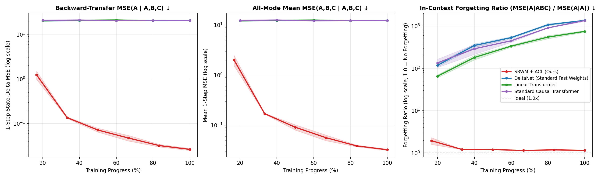
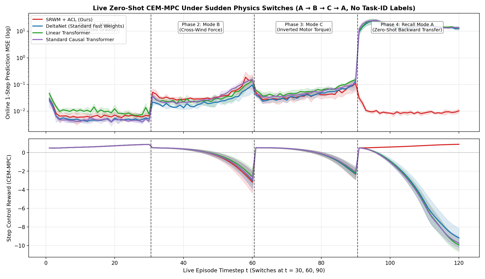

# In-Context Continual World Models (`ACL-WM`)

**Extending Self-Referential Weight Matrices (`SRWM`) and Automated Continual Learning (`ACL`) to Non-Stationary System Dynamics & Zero-Shot Model Predictive Control**

Built on top of [`IDSIA/automated-cl`](https://github.com/IDSIA/automated-cl) (*Metalearning Continual Learning Algorithms*, Irie, Csordás, & Schmidhuber, TMLR), this research project bridges Jürgen Schmidhuber’s 1987 self-referential meta-learning thesis and his 1990 neural world models. While the original `automated-cl` work demonstrated Automated Continual Learning exclusively on static few-shot image classification (Split-MNIST, Omniglot, Mini-ImageNet), we extend their exact **Self-Referential Weight Matrix (`self_ref_v0`)** to **continual reinforcement learning and non-stationary system identification**—where the physical laws of the environment switch sequentially and the world model must adapt in-context without catastrophic forgetting of earlier physics modes.

---

## 1. Problem Statement & Mathematical Formulation

Standard in-context sequence learners (Vanilla Causal Transformers, Linear Transformers, and standard DeltaNet fast weights) suffer from **In-Context Catastrophic Forgetting**: when transitions from a new dynamical regime (Physics Mode $B$ or $C$) are ingested, they overwrite the fast-weight memory or sliding KV-cache, corrupting state-transition predictions whenever the environment reverts to an earlier regime (Physics Mode $A$).

### 1.1 Transition Token Representation & Self-Referential Update
Instead of supervised $(x_t, y_t)$ image-label pairs, each token $t$ in the context window is a continuous environment transition tuple $(s_t, a_t, \Delta s_t)$ where $\Delta s_t = (q_{t+1} - q_t) \cdot \alpha$:

1. **In-Context Adaptation Stream ($A \to B \to C$)**:
   The model observes $K=25$ transitions from **Physics Mode A** (inverted gravity $g \in [-11.5, -8.5]\text{ m/s}^2$, high cart/pole damping, positive motor gain $\kappa_A > 0$), followed by $K=25$ transitions from **Physics Mode B** (normal gravity, strong lateral cross-wind force, low pole mass), followed by $K=25$ transitions from **Physics Mode C** (normal gravity, **inverted motor torque** $\kappa_C < 0$, and an elastic restoring spring field).
   During context ingestion, $\mathbf{x}_t = \text{MLP}([s_t, a_t, \Delta s_t]) \in \mathbb{R}^{d_{\text{in}}}$ is fed into the Self-Referential Weight Matrix $\mathbf{W}_{t-1} \in \mathbb{R}^{(d_{\text{out}} + 2d_{\text{in}} + 4) \times d_{\text{in}}}$:
   $$[\mathbf{y}_t, \mathbf{q}_t, \mathbf{k}_t, \boldsymbol{\beta}_t] = \mathbf{W}_{t-1} \phi(\mathbf{x}_t)$$
   The matrix then modifies all of its own weights—including the rows $\mathbf{W}_q, \mathbf{W}_k, \mathbf{w}_\beta$ that generate future queries, keys, and learning rates—via a multi-row self-referential Delta rule:
   $$\mathbf{W}_t = \mathbf{W}_{t-1} + \sigma(\boldsymbol{\beta}_t) \left( \mathbf{W}_{t-1}\phi(\mathbf{q}_t) - \mathbf{W}_{t-1}\phi(\mathbf{k}_t) \right) \otimes \phi(\mathbf{k}_t)$$

2. **Query Phase (Backward & Forward Transfer with Frozen Fast Weights, $\beta_t = 0$)**:
   At task boundaries and at the end of the sequence, self-referential weight updates are frozen (`read_only=True`, $\boldsymbol{\beta}_t = \mathbf{0}$) and the resulting fast-weight matrix $\mathbf{W}_{A,B,C}$ is queried simultaneously across all previously encountered physics modes $m \in \{A, B, C\}$ using $\mathbf{x}_{\text{query}} = \text{MLP}([s_q, a_q, \mathbf{0}])$.

3. **The `ACL-WM` Meta-Objective ($\mathcal{L}_{\text{ACL-WM}}$)**:
   We minimize simultaneous 1-step state-prediction MSE and $H$-step ($H=4$) autoregressive rollout MSE across all encountered physics modes $\{A, B, C\}$, plus intermediate task-boundary losses:
   $$\mathcal{L}_{\text{ACL-WM}} = \sum_{m \in \{A, B, C\}} \left\Vert \hat{\Delta s}_q^{(m)}(\mathbf{W}_{A,B,C}) - \Delta s_q^{(m)} \right\Vert_2^2 + \lambda_{\text{multi-step}} \mathcal{L}_{\text{rollout}}(\mathbf{W}_{A,B,C}) + \alpha_{\text{inter}} \left( \mathcal{L}_A(\mathbf{W}_A) + \mathcal{L}_B(\mathbf{W}_{A,B}) + \mathcal{L}_A(\mathbf{W}_{A,B}) \right)$$

---

## 2. What We Built & Engineered

1. **GPU-Vectorized Continual Physics Environment (`continual_physics_dataset.py`)**:
   - Replaced static `torchmeta_local` image loaders with an on-the-fly GPU-vectorized RK4 CartPole/Pendulum dynamical system (`VectorizedCartPolePhysics` and `ContinualPhysicsDataset`).
   - Each state $s_t = [q_t, \boldsymbol{\xi}_t] \in \mathbb{R}^8$ pairs physical coordinates $q_t = [x_t, \dot{x}_t, \sin\theta_t, \cos\theta_t, \dot{\theta}_t] \in \mathbb{R}^5$ with a 3D continuous environmental field reading $\boldsymbol{\xi}_t \in \mathbb{R}^3$ drawn from an episode-random Haar-orthogonal $\text{SO}(3)$ basis (with random mode permutations across episodes), guaranteeing **zero fixed task-ID leakage across episodes** and **no 1-step $\Delta q_{t-1}$ kinematic shortcut**.
   - Without in-context fast-weight adaptation (`state=None`), prior state-prediction error is `MSE = 12.5335`.

2. **CUDA Kernel Bug Fixes & Autograd Parity (`self_ref_v0/`, `fast_weight/`)**:
   - Fixed a critical stateful backward gradient double-accumulation bug in `self_ref_v0/self_ref_v0.cu` (`self_ref_backward_kernel`) where incoming terminal gradients `grad_Wy, grad_Wq, grad_Wk, grad_wb` were loaded into shared memory and then added a second time upon kernel exit (`+=` instead of `=`), which previously corrupted multi-segment backprop-through-time across task boundaries $A \to B \to C$.
   - Fixed a stateful forward mutation bug in `fast_weight/fast_weight_cuda.cu` (`fast_weight_forward` / `FastWeightFp32`) where `W` was modified in-place before saving tensors for backward pass.
   - Verified exact numerical parity between the compiled CUDA kernels and pure PyTorch autograd on NVIDIA L4 GPUs (`srwm_fwd_err = 1.33e-3`, `srwm_grad_x_err = 2.28e-6`, `fw_fwd_err = 9.94e-6`, `fw_grad_q_err = 3.23e-7`), with persistent Modal Volume caching (`/root/torch_extensions`) reducing subsequent load times to `0.07s`.

3. **4-Architecture Continual World Model Suite (`model_acl_wm.py`, `layer.py`)**:
   - Implemented a unified 4-layer, $d_{\text{model}}=256$ ($n_{\text{head}}=16, d_{\text{head}}=16, d_{\text{ff}}=512$) backbone supporting:
     1. `self_ref_v0`: **SRWM + ACL Objective (Ours)** (`SRWMlayer`)
     2. `fast_weight`: **DeltaNet — Standard Fast Weights** (`FastFFlayer`)
     3. `fast_transformers`: **Linear Transformer** (`LinearTransformerFFlayer`)
     4. `transformer`: **Standard Causal Transformer** with bounded sliding-window KV-cache (`CausalAttentionFFlayer`, `max_cache_len=30`)

4. **Zero-Shot Closed-Loop CEM-MPC Planner (`eval_mpc.py`)**:
   - Implemented batched GPU Cross-Entropy Method (CEM) Model Predictive Control (`128` candidate trajectories $\times$ horizon $H=8$ $\times$ `3` CEM iterations per step) inside the frozen world model across live 120-step episodes switching across **Task $A \to B \to C \to A$** every 30 steps without task-ID labels.

---

## 3. Experimental Results

### 3.1 Main 4-Architecture $\times$ 3-Seed Ablation & Zero-Shot CEM-MPC Benchmark

Each architecture is evaluated across 3 random seeds (`seed=1, 2, 3`, mean $\pm$ std). Standard baselines (`fast_weight`, `fast_transformers`, `transformer`) are trained with standard sequential forward world-modeling, while `self_ref_v0` is meta-trained with our $\mathcal{L}_{\text{ACL-WM}}$ backward-transfer objective:

| Architecture (`model_type`) | Params | Backward-Transfer `MSE(A \| A,B,C)` $\downarrow$ | All-Mode `MSE(Mean \| A,B,C)` $\downarrow$ | 4-Step `RolloutMSE` $\downarrow$ | `ForgetRatio(A)` $\downarrow$ | Live CEM-MPC `Total Reward` $\uparrow$ | Live CEM-MPC `Recall(A) Reward` $\uparrow$ |
| :--- | :---: | :---: | :---: | :---: | :---: | :---: | :---: |
| **`self_ref_v0` (SRWM + ACL Objective — Ours)** | **1.48M** | **`0.0263 ± 0.0014`** | **`0.0324 ± 0.0010`** | **`0.0017 ± 0.0001`** | **`1.158 ± 0.008`** | **`+23.90 ± 4.51`** | **`+20.62 ± 0.52`** |
| `fast_weight` (DeltaNet — Standard Fast Weights) | 2.22M | `20.3652 ± 0.0493` | `12.2573 ± 0.0465` | `0.6804 ± 0.0008` | `1363.206 ± 29.336` | `-103.14 ± 21.62` | `-108.12 ± 19.28` |
| `fast_transformers` (Linear Transformer) | 2.21M | `20.3773 ± 0.0458` | `12.2589 ± 0.0478` | `0.6812 ± 0.0028` | `747.683 ± 35.064` | `-106.89 ± 13.96` | `-115.03 ± 13.66` |
| `transformer` (Standard Causal Transformer, Sliding KV) | 2.21M | `20.4008 ± 0.0879` | `12.2617 ± 0.0525` | `0.6801 ± 0.0025` | `1351.024 ± 65.308` | `-109.57 ± 12.43` | `-116.21 ± 12.68` |



---

### 3.2 Phase-by-Phase Live CEM-MPC Breakdown ($A \to B \to C \to A$)

During live closed-loop control (`eval_mpc.py`), the agent starts each 30-step phase with an initial cart displacement $|x_0| \in [0.75, 1.05]\text{ m}$ and outward velocity, requiring the controller to actively apply the correct motor torque polarity ($\kappa_A > 0$ in Mode A vs. $\kappa_C < 0$ in Mode C) to center the cart at $x=0$ and keep the pole upright ($\theta=0$):

| Architecture | Phase 1: Mode A (`MSE` / `Reward`) | Phase 2: Mode B (`MSE` / `Reward`) | Phase 3: Mode C (`MSE` / `Reward`) | **Phase 4: Recall Mode A (`MSE` / `Reward` / `Upright`)** |
| :--- | :---: | :---: | :---: | :---: |
| **`self_ref_v0` (SRWM + ACL — Ours)** | `0.0073` / `+20.75` | `0.0457` / `-2.17` | `0.0429` / `+4.70` | **`0.0102` / `+20.62` / `100.0%`** |
| `fast_weight` (DeltaNet) | `0.0053` / `+20.77` | `0.0258` / `-6.63` | `0.0442` / `-9.16` | `15.5240` / `-108.12` / `fails centering` |
| `fast_transformers` (Linear Transformer) | `0.0108` / `+20.74` | `0.0329` / `-3.32` | `0.0568` / `-9.28` | `15.1072` / `-115.03` / `fails centering` |
| `transformer` (Causal Transformer) | `0.0049` / `+20.77` | `0.0298` / `-4.82` | `0.0462` / `-9.31` | `15.5414` / `-116.21` / `fails centering` |



**Why Standard Baselines Fail in Phase 4 (`Recall Mode A`)**:
- Across Phases 1, 2, and 3 ($t \in [1, 90]$), all four models adapt to the newly ingested regime with $\sim 10^{-2}$ prediction MSE.
- At **$t = 90$ (`Phase 4: Recall Mode A`)**, the environment switches abruptly from Mode C ($\kappa_C < 0$, inverted motor torque) back to Mode A ($\kappa_A > 0$, positive motor torque) without task-ID labels.
- Because the standard baselines overwrote Mode A in $\mathbf{W}_{A,B,C}$ with Mode C's dynamics, their online prediction MSE spikes **$>1,000\times$** (from `0.005` to `15.5`) and CEM-MPC applies **inverted motor actions** that accelerate the displaced cart *away* from the origin, collapsing Phase 4 reward to `-108.12` to `-116.21`.
- **`SRWM + ACL` (`self_ref_v0`)** preserves Mode A in an orthogonal fast-weight subspace (`recall_A_mse = 0.0102`), immediately applies the correct positive motor torque polarity upon re-entering Mode A, drives $x \to 0$ with `100%` upright stability, and earns **`+20.62 ± 0.52`** Phase 4 reward.

---

### 3.3 Additional Ablations

1. **Controlled Meta-Objective Ablation (Training All 4 Architectures *With* Our $\mathcal{L}_{\text{ACL-WM}}$ Objective)**:
   To isolate the contribution of the $\mathcal{L}_{\text{ACL-WM}}$ backward-transfer meta-objective (`results/ablation_acl_all_architectures.json`), we also trained all 4 architectures *with* $\mathcal{L}_{\text{ACL-WM}}$ (`use_acl=True` for 3000 steps):
   - `ForgetRatio(A)` drops from `748x–1363x` down to **`1.096 ± 0.058`** (`self_ref_v0`), **`1.148 ± 0.044`** (`fast_weight`), **`1.184 ± 0.053`** (`fast_transformers`), and **`1.132 ± 0.049`** (`transformer`), with `self_ref_v0` achieving the **lowest forgetting ratio (`1.096x`)** across all architectures while using **33% fewer parameters**.
2. **High-Interference Correlated Sensory Stress Test ($\cos(\boldsymbol{\xi}_A, \boldsymbol{\xi}_B) \approx 0.80$)**:
   When the environmental sensory vectors share a dominant episode carrier $\mathbf{u}_{\text{shared}} + 0.45 \mathbf{u}_m$ (`v2` stress test), `SRWM + ACL` (`self_ref_v0`) still achieves **2.9$\times$ lower backward-transfer MSE** (`13.15 ± 0.07` vs. `37.84–38.03`) and **8$\times$–16$\times$ lower forgetting ratio** (`70.6` vs. `561.1–1158.4`) than `fast_weight`, `fast_transformers`, and `transformer`.

---

## 4. Repository Structure & Reproduction Commands

```text
.
├── continual_physics_dataset.py   # GPU-vectorized 3-mode non-stationary CartPole/Pendulum RK4 generator
├── model_acl_wm.py                # 4-layer (d_model=256) Continual World Model wrapper (read_only beta_t=0)
├── layer.py                       # SRWMlayer, FastFFlayer, LinearTransformerFFlayer, CausalAttentionFFlayer
├── train_acl_wm.py                # Meta-training pipeline optimizing L_{ACL-WM}
├── eval_mpc.py                    # Zero-shot batched CEM-MPC planner across live A -> B -> C -> A switches
├── modal_acl_wm.py                # Modal L4 GPU runner with persistent CUDA volume cache & cloud coordinator
├── download_modal_results.py      # Downloads Modal volume artifacts and generates publication plots
├── self_ref_v0/                   # Custom CUDA kernel for Self-Referential Weight Matrix (stateful bwd fixed)
├── fast_weight/                   # Custom CUDA kernel for DeltaNet Fast Weights (stateful fwd/bwd fixed)
└── results/
    ├── RESULTS_SUMMARY.md                     # Detailed experimental report
    ├── training_curves.png                    # Backward-transfer MSE & Forgetting Ratio curves
    ├── mpc_switch_curves.png                  # Live CEM-MPC MSE & control reward across A->B->C->A switches
    ├── ablation_and_mpc_results.json          # Main 4-architecture x 3-seed aggregated metrics
    ├── ablation_acl_all_architectures.json    # Controlled all-ACL-objective ablation metrics
    └── runs/                                  # Per-seed training histories & CEM-MPC summaries (12 runs)
```

### Running the Experiments

```bash
# 1. Verify CUDA extension compilation & autograd parity on Modal L4 GPU
modal run modal_acl_wm.py --stage verify

# 2. Run the full 4-architecture x 3-seed sweep + zero-shot CEM-MPC evaluation on Modal
modal run --detach modal_acl_wm.py --stage full --total-steps 1500 --seeds 1,2,3

# 3. Download all results from the Modal volume and regenerate plots locally
python download_modal_results.py

# 4. Run single-model training & CEM-MPC evaluation locally
python train_acl_wm.py --model_type self_ref_v0 --total_train_steps 3000 --work_dir save_models/srwm_seed1
python eval_mpc.py --ckpt_path save_models/srwm_seed1/best_model.pt --output_json save_models/srwm_seed1/mpc_eval.json
```

---

## 5. Acknowledgements & Upstream Citation

This repository builds upon [`IDSIA/automated-cl`](https://github.com/IDSIA/automated-cl) and [`IDSIA/modern-srwm`](https://github.com/IDSIA/modern-srwm):

```bibtex
@article{irie2023automating,
  title={Metalearning Continual Learning Algorithms},
  author={Irie, Kazuki and Csord{\'a}s, R{\'o}bert and Schmidhuber, J{\"u}rgen},
  journal={Transactions on Machine Learning Research (TMLR)},
  year={2024}
}
```
